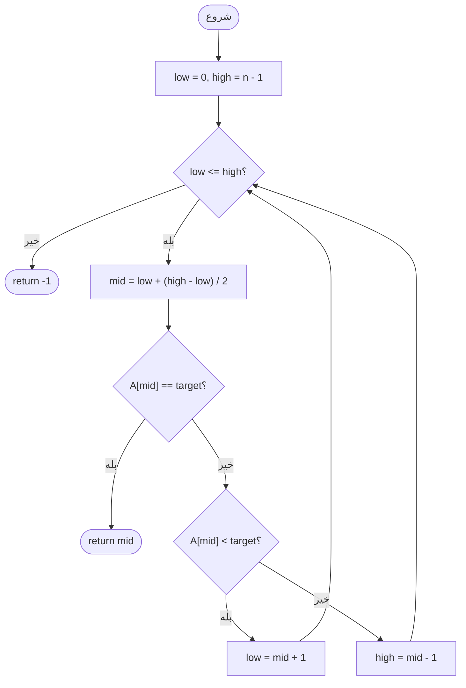
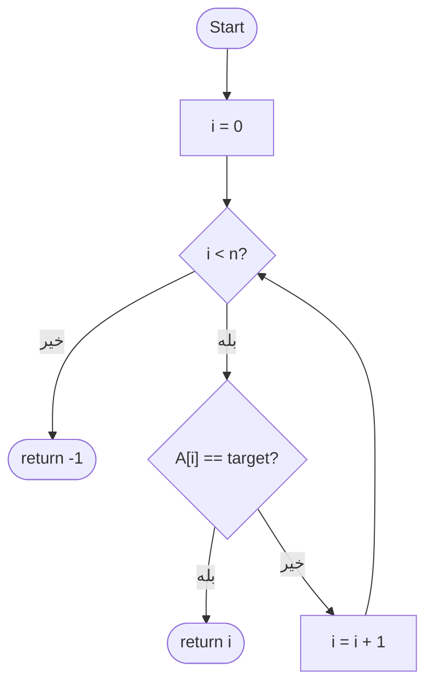
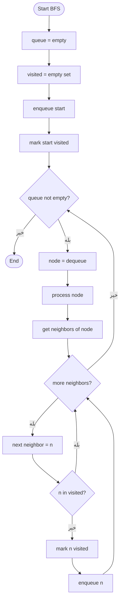
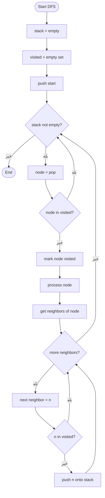
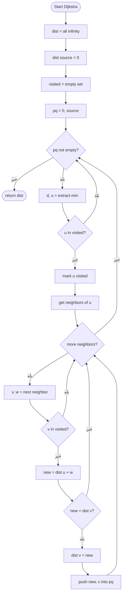

# الگوریتم های جستجو

فهرستی از معروف ترین و پر استفاده ترین الگوریتم های جستجو

| رتبه | الگوریتم       | حوزه              |
|------|-----------------|---------------------|
| 1    | جستجوی دودویی   | آرایه های مرتب       |
| 2    | جستجوی خطی   | هر نوع داده            |
| 3    | جستجوی سطحی (BFS)             | گراف ها              |
| 4    | جستجوی عمقی (DFS)             | گراف ها              |
| 5    | دایکسترا      | گراف های وزن دار     |

---

## 1. جستجوی دودویی

**ایده:** نصف کردن مکرر آرایه ای مرتب و مقایسه عنصر هدف با عنصر میانه

**پیچیدگی:** `O(log n)` زمانی, `O(1)` فضایی.

### شبه کد

```text
BINARY_SEARCH(A, target):
    low = 0
    high = length(A) - 1
    while low <= high:
        mid = low + (high - low) / 2
        if A[mid] == target:
            return mid
        else if A[mid] < target:
            low = mid + 1
        else:
            high = mid - 1
    return -1
```

### فلوچارت



---
## 2. جستجوی خطی

**ایده:** عناصر را یکی پس از دیگری به ترتیب بررسی می کند تا عنصر هدف پیدا شود

**پیچیدگی:** `O(n)` زمانی, `O(1)` فضایی.

### شبه کد

```text
LINEAR_SEARCH(A, target):
    for i from 0 to length(A) - 1:
        if A[i] == target:
            return i
    return -1
```

### فلوچارت



---

## 3. جستجوی سطحی (BFS)

**ایده:** گرافی را سطح به سطح با استفاده از **صف** کاوش می کند. تمامی گره ها با فاصله 1 و سپس 2 و... را بررسی می کند

**پیچیدگی:** `O(V + E)` زمانی, `O(V)` فضایی.

**بهینه برای:** کوتاه ترین مسیر در گراف بی وزن, وب کرال(پیدا کردن لینک ها تا عمق مشخص), حل پازل.

### شبه کد

```text
BFS(graph, start):
    queue = empty
    visited = empty set
    enqueue start into queue
    mark start as visited

    while queue is not empty:
        node = dequeue from queue
        process(node)
        for each neighbor of node:
            if neighbor not in visited:
                mark neighbor as visited
                enqueue neighbor into queue
```

### فلوچارت



---

## 4. جستجوی عمقی (DFS) — تکرارشونده

**ایده:** یک شاخه گراف را با استفاده از **پشته** قبل از برگشت عمیقا کاوش می کند 

**پیچیدگی:** `O(V + E)` زمانی, `O(V)` فضایی.

**بهینه برای:** پیدا کردن دور, مرتب سازی توپولوژیک, مولفه های همبند, حل هزارتو, بازگشت به عقب.

> توجه: نسخه بازگشتی این الگوریتم رایج تر است اما برای سادگی نسخه تکرار شونده اینجا آورده شده است
>

### شبه کد

```text
DFS(graph, start):
    stack = empty
    visited = empty set
    push start onto stack

    while stack is not empty:
        node = pop from stack
        if node not in visited:
            mark node visited
            process(node)
            for each neighbor of node:
                if neighbor not in visited:
                    push neighbor onto stack
```

### فلوچارت



---

## 5. الگوریتم دایکسترا

**ایده:** کوتاه‌ترین مسیر از یک گره مبدأ به همه گره‌های دیگر را در یک گراف وزن‌دار با وزن‌های **نامنفی** پیدا می‌کند. از یک **صف اولویت‌** (min-heap) استفاده می‌کند تا همیشه نزدیک‌ترین گره بازدید‌نشده را گسترش دهد.

**پیچیدگی:** `O((V + E) log V)` زمانی با استفاده از هرم دودویی, `O(V)` فضایی.

**بهینه برای:** ناوبری GPS, مسیریابی شبکه (OSPF), هوش مصنوعی بازی, مسائل کوتاه ترین مسیر وزن دار.

### شبه کد

```text
DIJKSTRA(graph, source):
    dist = array of size V, all = infinity
    dist[source] = 0
    visited = empty set
    pq = priority queue containing (0, source)

    while pq is not empty:
        (d, u) = extract-min from pq
        if u in visited:
            continue
        mark u visited

        for each (v, weight) in neighbors of u:
            if v not in visited:
                new_dist = dist[u] + weight
                if new_dist < dist[v]:
                    dist[v] = new_dist
                    push (new_dist, v) into pq

    return dist
```

### فلوچارت



---

## جدول مقایسه

| | جستجوی دودویی | جستجوی خطی | جستجوی سطحی | جستجوی عمقی | دایکسترا |
|---|---|---|---|---|---|
| **ساختمان داده** | - | - | صف (FIFO) | پشته (LIFO) | Min-heap |
| **ورودی** | آرایه مرتب | هر آرایه | گراف | گراف | گراف وزن دار |
| **وزن یال** | - | - | - | - | نامنفی |
| **هدف** | اندیس عنصر | اندیس عنصر | کوتاه ترین مسیر (بی وزن) | هر مسیر | کوتاه ترین مسیر (وزن دار) |
| **پیچیدگی زمانی** | `O(log n)` | `O(n)` | `O(V + E)` | `O(V + E)` | `O((V + E) log V)` |
| **پیچیدگی فضایی** | `O(1)` | `O(1)` | `O(V)` | `O(V)` | `O(V)` |

---

